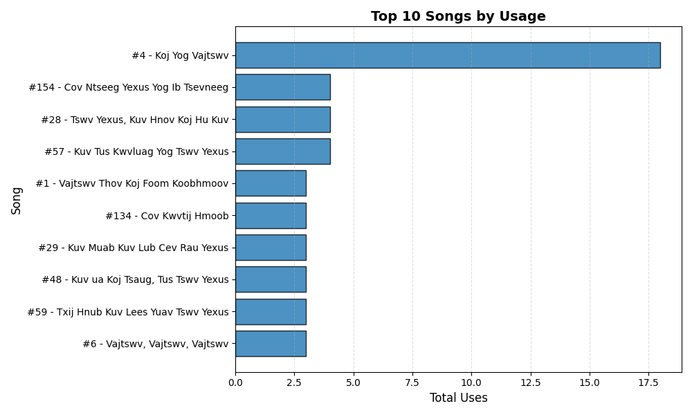
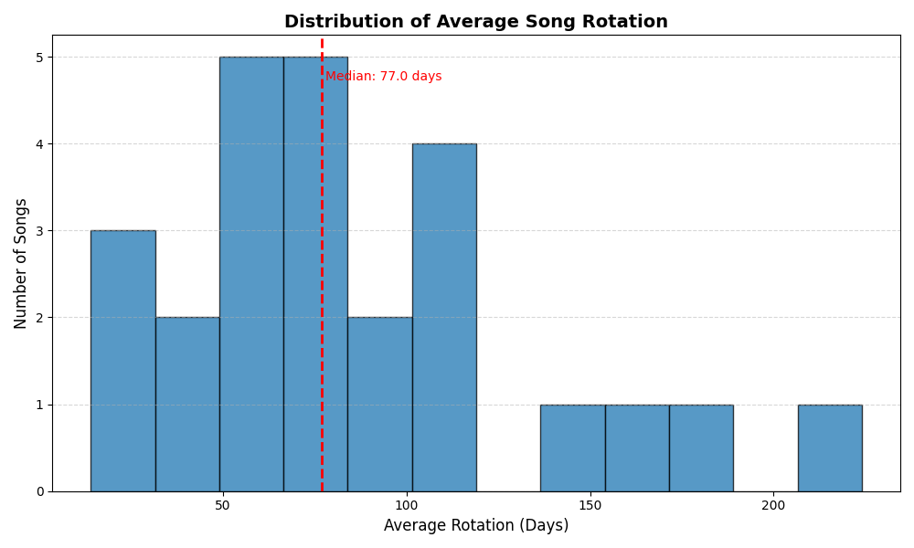

# HFBC Worship Analytics
## Scope
Operational reporting example for historical song usage and rotation. Relevant analyst skills include data preparation, tabular modeling, grouping, joins, KPI reporting and chart generation.

## Files and workflow
- `data/setlist.xlsx`: source workbook.
- `notebooks/build_song_usage_data.py`: prepares date/song dimensions and song-usage facts.
- `notebooks/song_usage_kpi_report.py`: reads prepared CSVs, joins song metadata, calculates usage/rotation/recency metrics and writes reports/charts.
- `outputs/`: saved dimension, fact and KPI CSVs; `outputs/figures/`: generated PNG charts.
- `requirements.txt`: dependencies.
```bash
pip install -r requirements.txt
python notebooks/build_song_usage_data.py
python notebooks/song_usage_kpi_report.py
```
Review source paths and schemas before running.

## Metric definitions
The report counts song appearances, averages recorded DaysSinceLast values, finds last-use dates and applies configurable threshold rules. The current thresholds flag average rotation below 21 days and last use more than 90 days ago.

## Important limitations
Recency defaults to the last source date, producing a stable historical snapshot. Use `python notebooks/song_usage_kpi_report.py --as-of 2026-10-23` for a later explicit reporting date. Dates before the last source date are rejected. Metadata joins require unique, populated song names and full fact coverage; a duplicate dimension cannot silently multiply appearances. Distinguish song appearances from services and account for incomplete history and missing intervals.

Usage frequency alone does not demonstrate congregation fatigue, worship quality or the reason a song was selected. Threshold flags are planning prompts, not conclusions about people or ministry performance.





## Validation and saved outputs
Run `python -m unittest discover -s tests -v` for four date/join checks. The included workbook rebuilds 172 song appearances across 118 songs; the last source date is February 15, 2026. The KPI export records `report_as_of`. The saved CSVs and charts have been regenerated for that historical date; they are not a current service schedule. Date/join improvements were developed with AI assistance. This is a supporting operations-reporting project, not one of the two resume projects.
